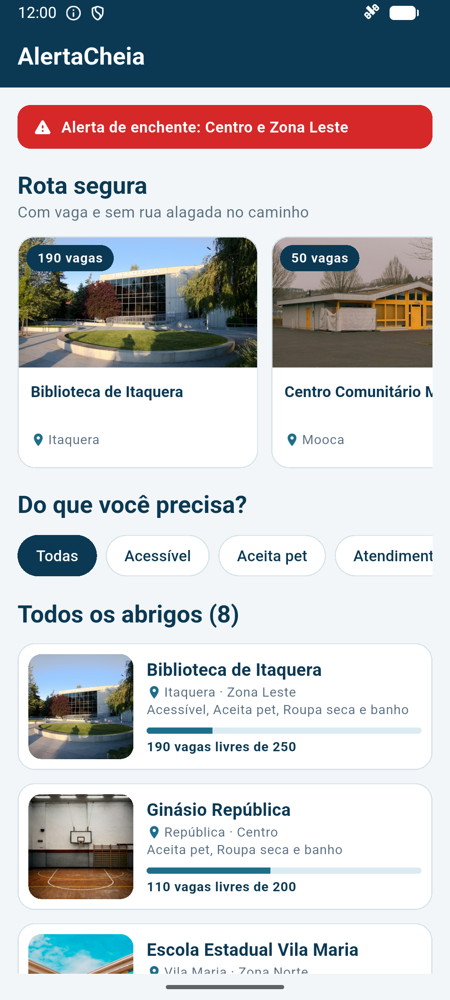
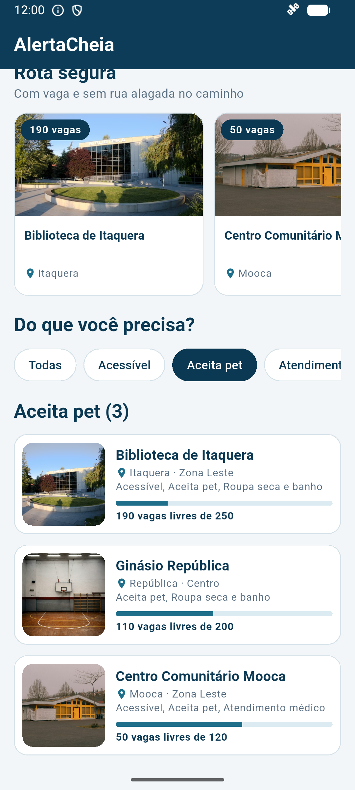
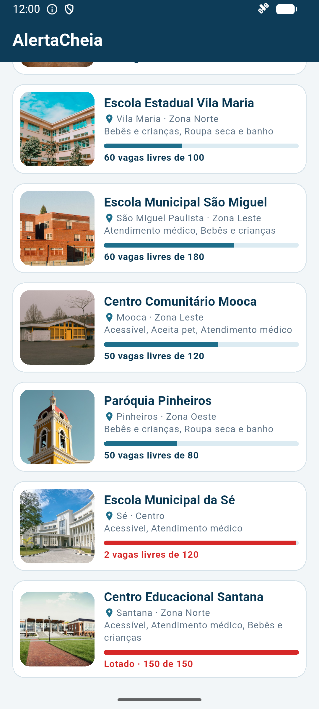

# AlertaCheia · Flutter

App Flutter do AlertaCheia, feito em Dart para a Global Solution 2026.2 da FIAP.

## Desenvolvedores

| Nome completo | RM |
| --- | --- |
| Filipi de Oliveira | 555484 |
| João Gabriel Silva dos Santos | 575198 |

Equipe CulturaC6, turma 3SIZ.

## Tema da Global Solution

Desafio FIAP CitizenTech. O nosso problema são as enchentes.

## A solução

Quando chega o alerta de enchente, o morador desalojado precisa saber para qual abrigo ir. O AlertaCheia mostra numa tela só as regiões em alerta, os abrigos com vaga e a lista completa, filtrada pelo que ele precisa.

## Funcionalidades

- **Alerta de enchente:** faixa no topo com as regiões em alerta.
- **Rota segura:** abrigos com vaga e sem rua alagada no caminho, escolhidos por uma regra no repositório.
- **Filtro por necessidade:** chips de Todas, Acessível, Aceita pet, Atendimento médico, Bebês e crianças e Roupa seca e banho.
- **Lista de abrigos:** foto, nome, bairro, atendimentos e barra de ocupação, ordenada por vagas. Com 10 vagas ou menos, fica vermelho.

## Fluxo de telas

O app tem uma tela, a `HomeScreen`. Ela abre no alerta e na Rota segura. Ao tocar num chip, a lista abaixo mostra só os abrigos com aquele atendimento. "Todas" volta para a lista completa.

## Prints

| Início | Filtro "Aceita pet" | Fim da lista |
| --- | --- | --- |
|  |  |  |

## API utilizada

Nenhuma. Os dados ficam num repositório em memória, a classe `AbrigoRepository`, com 8 abrigos fictícios de São Paulo. As fotos vêm do [Unsplash](https://unsplash.com) e são carregadas com `Image.network`.

## Arquitetura

```
lib/
├── main.dart                     abre o app no tema e na HomeScreen
├── models/
│   ├── categoria.dart            enum com os 5 atendimentos
│   └── abrigo.dart               classe do abrigo
├── data/
│   └── abrigo_repository.dart    dados, filtro, ordenação e regra da Rota segura
├── widgets/
│   ├── abrigo_list_item.dart     card da lista vertical
│   ├── categoria_selector.dart   chips do filtro
│   ├── rota_segura_section.dart  alerta e destaques horizontais
│   └── foto_abrigo.dart          foto usada na lista e nos destaques
├── screens/
│   └── home_screen.dart          junta tudo e guarda a categoria escolhida
└── theme/
    └── app_theme.dart            cores e tema
test/
└── abrigo_repository_test.dart   testes do filtro, da ordenação e da Rota segura
```

O repositório filtra, ordena e decide os destaques. A `HomeScreen` é um `StatefulWidget` que guarda a categoria e chama `setState` no toque do chip. Os widgets só desenham o que recebem.

## Como rodar

Com o Flutter instalado, rodar `flutter pub get` e depois `flutter run`, num emulador Android ou no Chrome, com internet para as fotos. Os testes rodam com `flutter test`.

## Vídeo pitch

Link do vídeo: a definir
